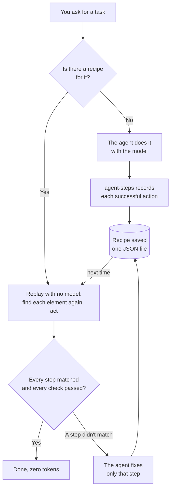
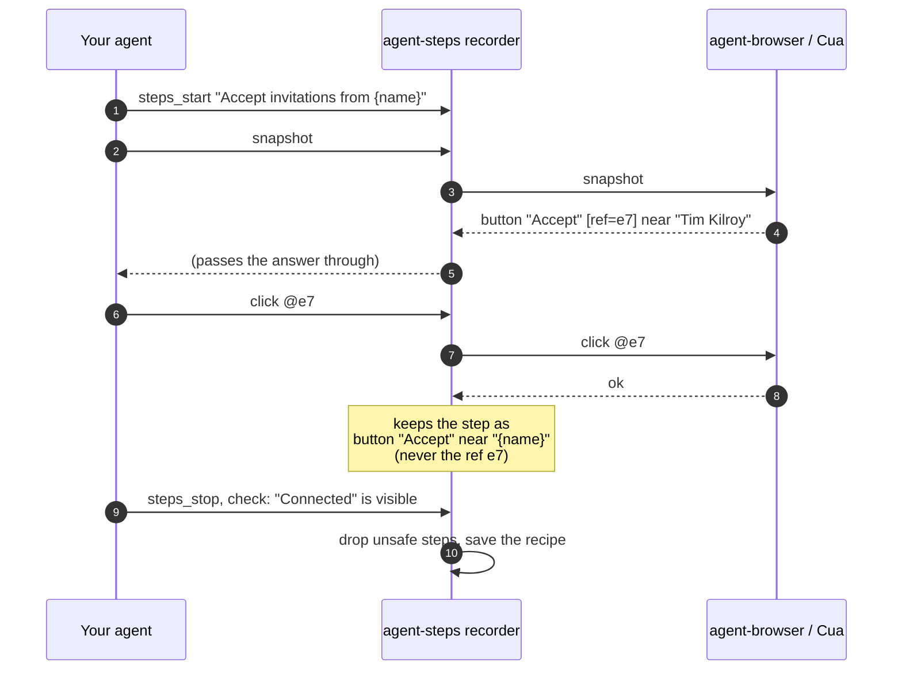
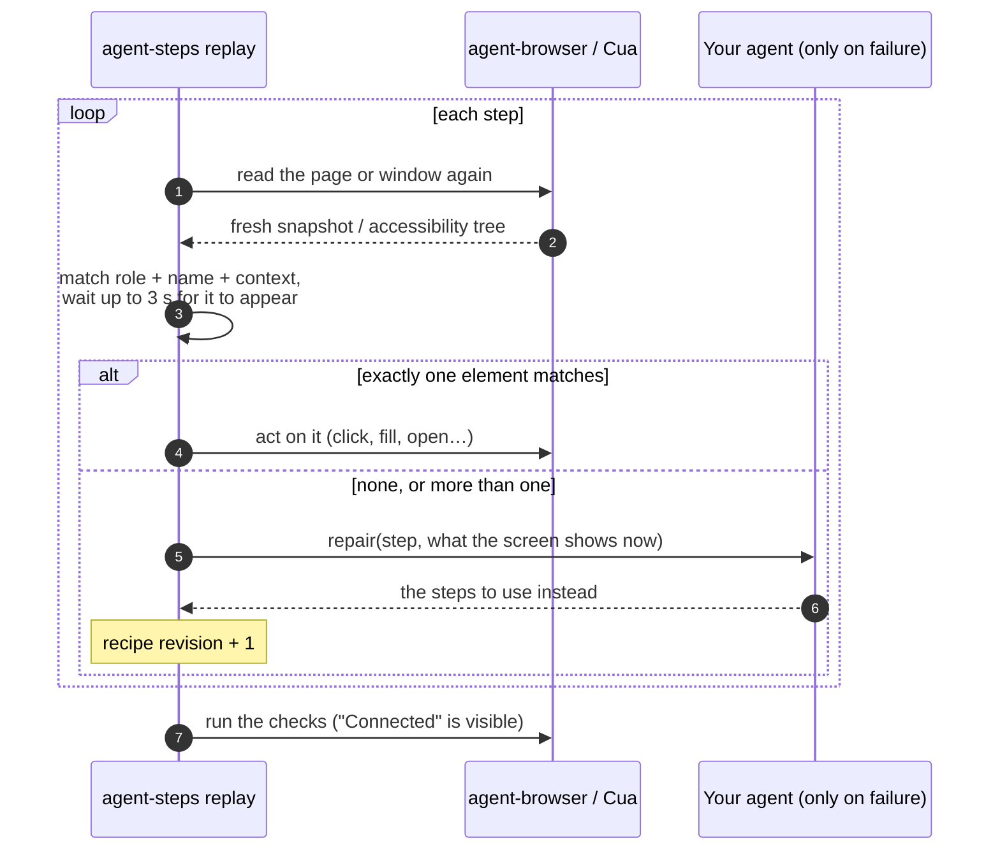
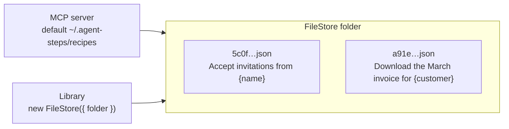
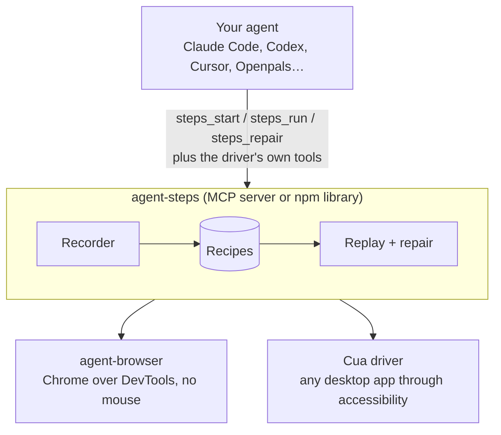
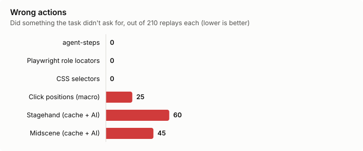
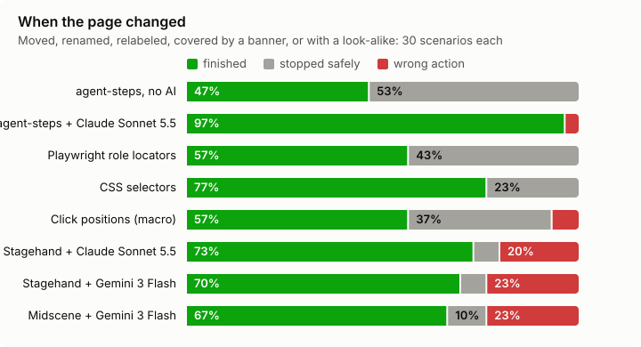
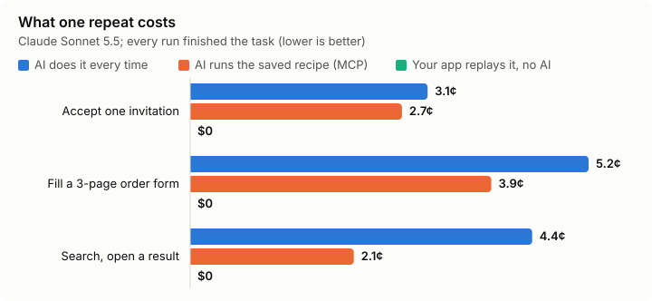

# agent-steps

**Teach your agent a task once. Repeat it without the model.**

[](https://github.com/legalcap/agent-steps/actions/workflows/ci.yml)
[](LICENSE)
[](https://github.com/legalcap/agent-steps/releases)

An open-source project by [Legalcap](https://www.legalcap.ai), where we build AI agents for legal operations.

agent-steps watches an AI agent do a task in a browser ([agent-browser](https://github.com/vercel-labs/agent-browser))
or on a desktop ([Cua](https://github.com/trycua/cua)'s computer driver), saves what it did as a small JSON recipe, and
repeats it later with no model calls. Each step remembers *what* it touched (a button by its role and name, an app's
control by its label), not *where* it was, so a repeat still works when the page or the window moves. When a step no
longer matches, only that step goes back to your agent to fix, and the recipe comes back one revision on.

**At a glance** (details and every caveat in [Benchmarks](#benchmarks)):

- A repeat costs **$0 and under a second**, against about 4¢ and 9 s for the AI doing the task again.
- When the page changed, it **never did the wrong thing** on its own: it stops instead. With the AI taking over where
  it stops, it finished **97%** of changed pages. Stagehand and Midscene, which guess with a model, did something the
  task didn't ask for in 9 to 12 of 42 scenarios.
- On **15 tasks from Stagehand's own eval suite**, it saved 13 recipes, and all 39 replays finished with no AI.
- It **never saves** final actions (send, pay, delete, merge, sign out…), passwords or keys.

> [!NOTE]
> Version 0.2: the API and the recipe format can still change.

## Why we built it

Legal operations are full of tasks done the same way again and again in the same web apps and desktop programs, and
in legal work a click on the wrong record is not acceptable. We wanted our agents to learn such a task once, repeat it
as plain code, and stop and ask the moment anything looked different.

AI agents are great at figuring out how to do something on a screen, and wasteful at doing the same thing again: every
repeat costs tokens, takes longer and can go differently. Recorded macros are cheap but break as soon as a button moves,
because they store pixel positions. agent-steps keeps the best of both: the agent discovers, plain code repeats, and the
agent only comes back when the screen really changed.

## How it works



### Recording: from a ref to a meaning

An agent acts on what it just read: agent-browser answers a snapshot such as `- button "Accept" [ref=e7]` and the agent
clicks `@e7`; Cua answers a window's accessibility tree and the agent clicks element 12. Those refs and indexes change on
every read, so the recorder never keeps them. It looks the element up in the snapshot read just before the action and
stores what it *is*.



Typed text that equals one of the task's inputs becomes a placeholder (`Tim Kilroy` → `{name}`), so one recipe serves
every value.

### Replaying: find exactly one, or stop



It never guesses: zero matches or two matches is a failure, not a coin toss.

### What a step remembers

| | A recorded macro | agent-steps |
| --- | --- | --- |
| Web | click at (812, 433) | `button "Accept"` near `Tim Kilroy`, on `linkedin.com/mynetwork/invitation-manager` |
| Desktop | click at (120, 40) | app `com.apple.mail`, window `New Message`, `AXButton` labelled `Send`, inside `AXToolbar` |
| Moves when | the layout changes | only when the element itself is gone or renamed |

## Where recipes are kept



- **One JSON file per recipe**, in a folder you choose. The MCP server uses `~/.agent-steps/recipes` unless you pass
  `--store <folder>`.
- Up to 200 recipes per store; one unused for 60 days is dropped.
- A recipe never contains screenshots, page text, passwords or anything typed into a secret field.
- Every recipe is validated again when it's loaded, so a hand-edited or damaged file can't run.
- In [Openpals](https://github.com/borjasolerme/Openpals), each bot has its own store on its server
  (`<data>/bots/<bot>/saved-steps/`).

## Architecture



- **Drivers** are thin adapters. `agentBrowserDriver` reads agent-browser snapshots and acts by ref after finding the
  element again; `cuaDriver` reads Cua's window state and acts on the matching element. A recipe can mix both (open a
  page, then attach the downloaded PDF in Mail).
- **A caller** is anything with `call(tool, args, signal)`: an MCP client, an HTTP bridge, a test fake. agent-steps
  never starts browsers or touches the screen by itself.

## Safety

A replay has no model to notice that something is off, so agent-steps is built to stop rather than guess.

**Never saved**, so never repeated without the agent deciding again:

- final actions it can recognise by name: send, delete, pay, submit, post, publish, merge, deploy, refund, sign out
  and their like, in 16 languages;
- anything typed into a password or other secret field, and any typed text that looks like a key or token (pass those
  as inputs: an input is given at each run and never stored);
- flipping a checkbox whose state wasn't read first;
- acting by pixel position. There is no fallback to a point on the screen.

**Checked again at every run**, wherever the recipe came from: `replay()` refuses a recipe that would not load, and
checks each step once more after its inputs are filled in, so an input cannot turn a step into a final action. A step
recorded on one page does not run on another, and a recipe unused for 60 days is deleted from the folder.

**What this does not promise.** "Final action" is a list of words, not a proof. A button called "Accept", "Continue"
or "Yes" is saved, even where pressing it matters. Two things cover that: `steps_stop` answers with every step the
recipe will repeat, so whoever recorded it sees them; and a host that needs a person's yes passes `approve` to
`replay()`, which is asked before each step.

The `strict` policy (used by Openpals) also only saves a recipe when the typed text and links appear in the person's
own request, and refuses requests that depend on the moment ("the latest", "this one").

## Install

```bash
npm install agent-steps   # Node 22.18 or newer
```

## Use it as an MCP server

Put it in front of the driver's own MCP server. Every driver tool passes through, and five are added:

```bash
npx agent-steps mcp --driver agent-browser -- npx agent-browser mcp
npx agent-steps mcp --driver cua --store ~/recipes -- cua-driver mcp
```

Claude Code:

```bash
claude mcp add agent-steps -- npx agent-steps mcp --driver agent-browser -- npx agent-browser mcp
```

Codex (`~/.codex/config.toml`) and Cursor (`.cursor/mcp.json`) take the same command and arguments.

| Tool | Does |
| --- | --- |
| `steps_start { name, inputs? }` | Starts recording the calls that follow |
| `steps_stop { checks?, discard? }` | Saves the recording as a recipe |
| `steps_list` | Lists saved recipes |
| `steps_run { name, inputs? }` | Repeats a recipe with no model; says which step failed if one did |
| `steps_repair { name, at, inputs? }` | Keeps the steps before `at`, records the rest again, revision + 1 |

A good instruction for your agent: *"Before a browser or desktop task, check `steps_list`. If a recipe fits, use
`steps_run`; otherwise wrap the task in `steps_start` and `steps_stop`."*

What the agent is told along the way:

- `steps_start` answers with what to keep to while recording (act on refs from a snapshot, no JavaScript, no tabs, no
  final buttons).
- A call that makes the recording unsavable says so at once, instead of at `steps_stop` when the task is done.
- `steps_stop` lists every step the recipe will repeat, keeps a check only if the page says it at that moment, and
  explains a refusal.

Options: `--store <folder>` (default `~/.agent-steps/recipes`), `--wait <seconds>` for slow pages (3 by default), and
`--full-answers`. Without it, a browser's answers are passed on as their text alone: agent-browser repeats each answer
several times over in its structured part, which made large pages too long for the agent to read.

What it does not record: several tabs, running JavaScript, file uploads, drags, and anything in [Safety](#safety).

## Use it as a library

```ts
import { agentBrowserDriver, createRecorder, FileStore, replay } from "agent-steps";

const driver = agentBrowserDriver(caller);             // caller.call(tool, args, signal) reaches agent-browser
const recorder = createRecorder({ driver });
await recorder.call("agent_browser_open", { url: "https://example.com/" });
await recorder.call("agent_browser_snapshot", {});
await recorder.call("agent_browser_click", { selector: "@e5" });
const saved = recorder.stop({ name: "Open billing", checks: ["Invoices"] });

const store = new FileStore({ folder: "./recipes", policy: "standard" });
if (saved.ok) store.save(saved.recipe);

const outcome = await replay(store.find("open billing")!, {
  driver,
  inputs: {},
  repair: async (step, context) => null, // ask your model; return the steps to put in its place
});
```

`cuaDriver(caller)` does the same on a desktop. Pass several drivers (`driver: [web, desktop]`) to record and replay a
task that crosses both.

## Recipe format

```json
{
  "version": 2,
  "id": "5c0f…",
  "name": "Open billing and download the March invoice for {customer}",
  "key": "open billing and download the march invoice for {customer}",
  "request": "Open billing and download the March invoice for {customer}",
  "revision": 1,
  "inputs": ["customer"],
  "steps": [
    { "driver": "agent-browser", "tool": "open", "args": { "url": "https://example.com/" } },
    { "driver": "agent-browser", "tool": "click", "args": {}, "target": { "role": "link", "name": "Billing", "url": "https://example.com/" } },
    { "driver": "agent-browser", "tool": "fill", "args": { "text": "{customer}" }, "target": { "role": "searchbox", "name": "Customer" } },
    { "driver": "cua", "tool": "click", "args": {}, "app": { "bundleId": "com.apple.Preview", "name": "Preview" },
      "window": { "title": "invoice.pdf" }, "element": { "role": "AXButton", "label": "Share", "path": ["AXToolbar:"] } }
  ],
  "checks": [{ "kind": "text-visible", "driver": "agent-browser", "text": "Invoice" }],
  "createdAt": 1790000000000, "updatedAt": 1790000000000, "lastUsedAt": 1790000000000
}
```

## Benchmarks

Six everyday web tasks on a local test site, each recorded once, then replayed on the same page and on six changed
versions of it. The site's own log decides what really happened.

<!-- bench:start -->
<!-- Generated by `node bench/render.ts` from bench/results/. Edit the text around it, not inside. -->



On its own, agent-steps never did the wrong thing; with the AI finishing what stops, 1 of 42. The ones that guess: Click positions (macro): 5, Stagehand + Claude Sonnet 5.5: 10, Stagehand + Gemini 3 Flash: 12, Midscene + Gemini 3 Flash: 9.



Alone, agent-steps finishes 47% of changed pages and stops on the rest. With the AI taking over where it stops, 97%.



A repeat costs nothing and takes 0.7 s when your app runs the recipe, against 4.2¢ and 9 s for the AI doing it again. When the AI itself calls the recipe over MCP the saving is small (2.9¢, 7 s): most of the cost is the AI's own turn. Recording once costs 5.5¢.

**On pages we did not write** (15 tasks from Stagehand's own eval suite, Claude Sonnet 5.5): the AI did 15 of 15 on its own. agent-steps saved a recipe for 13 (8 at the first try, the rest after the AI recorded again) and for 2 never. 39 of 39 replays of the saved ones finished the task with no AI. That run found bugs, fixed since: before the fixes 36 of 39 replays finished, and agent-steps reported 9 failures where 3 were real.

<details><summary>All the numbers</summary>

#### Every approach, in scenarios

A scenario is one task on one version of the page. It counts as finished only if every repeat finished, and as wrong if any repeat did something the task didn't ask for.

| Approach | Same page: finished | Changed pages: finished / stopped / wrong | Target gone: stopped / wrong |
| --- | --- | --- | --- |
| agent-steps, no AI | 5/6 | 14 / 16 / 0 of 30 | 6 / 0 of 6 |
| agent-steps + Claude Sonnet 5.5 | 6/6 | 29 / 0 / 1 of 30 | 6 / 0 of 6 |
| Playwright role locators | 6/6 | 17 / 13 / 0 of 30 | 6 / 0 of 6 |
| CSS selectors | 6/6 | 23 / 7 / 0 of 30 | 6 / 0 of 6 |
| Click positions (macro) | 6/6 | 17 / 11 / 2 of 30 | 3 / 3 of 6 |
| Stagehand + Claude Sonnet 5.5 | 6/6 | 22 / 2 / 6 of 30 | 2 / 4 of 6 |
| Stagehand + Gemini 3 Flash | 6/6 | 21 / 2 / 7 of 30 | 1 / 5 of 6 |
| Midscene + Gemini 3 Flash | 6/6 | 20 / 3 / 7 of 30 | 4 / 2 of 6 |

#### No model: replays on BASE and on perturbed pages

Results file: [`bench/results/no-model-2026-11-18.json`](bench/results/no-model-2026-11-18.json) · 2026-11-18T20:58:59.331Z · Node v22.22.2 · Playwright 1.64.1 (Chromium 156.0.8078.4) · agent-browser 0.37.0 · agent-steps f900b91 · Apple M2 Pro, 10 cores, 16 GB, darwin 27.0.0 arm64 · N = 5 per cell · action timeout 3000 ms.

**Summary.** 6 tasks × 7 variants × 5 runs per contender. "Perturbed" is the five variants where the task can still be done (moved, renamed, relabeled, overlay, duplicate); on "removed" the only good outcome is a safe stop.

| Contender | Success on BASE | Success on perturbed | Dangerous on perturbed | Safe stop on removed | Dangerous on removed | Median time on BASE |
| --- | --- | --- | --- | --- | --- | --- |
| agent-steps | 25/30 (83%) | 70/150 (47%) | 0/150 (0%) | 30/30 | 0/30 | 610 ms |
| Coordinate macro | 30/30 (100%) | 85/150 (57%) | 10/150 (7%) | 15/30 | 15/30 | 957 ms |
| CSS selectors (DevTools style) | 30/30 (100%) | 115/150 (77%) | 0/150 (0%) | 30/30 | 0/30 | 93 ms |
| Playwright role locators | 30/30 (100%) | 85/150 (57%) | 0/150 (0%) | 30/30 | 0/30 | 101 ms |

**By variant** (success / safe failure / dangerous, out of 30 runs: 6 tasks × 5):

| Contender | base | moved | renamed | relabeled | overlay | duplicate | removed |
| --- | --- | --- | --- | --- | --- | --- | --- |
| agent-steps | 25 / 5 / 0 | 25 / 5 / 0 | 25 / 5 / 0 | 0 / 30 / 0 | 20 / 10 / 0 | 0 / 30 / 0 | 0 / 30 / 0 |
| Coordinate macro | 30 / 0 / 0 | 0 / 30 / 0 | 30 / 0 / 0 | 30 / 0 / 0 | 25 / 5 / 0 | 0 / 20 / 10 | 0 / 15 / 15 |
| CSS selectors (DevTools style) | 30 / 0 / 0 | 30 / 0 / 0 | 0 / 30 / 0 | 30 / 0 / 0 | 25 / 5 / 0 | 30 / 0 / 0 | 0 / 30 / 0 |
| Playwright role locators | 30 / 0 / 0 | 30 / 0 / 0 | 30 / 0 / 0 | 0 / 30 / 0 | 25 / 5 / 0 | 0 / 30 / 0 | 0 / 30 / 0 |

<details><summary>Every task × variant (S success, s safe failure, D dangerous; one letter per run)</summary>

| Task | Contender | base | moved | renamed | relabeled | overlay | duplicate | removed |
| --- | --- | --- | --- | --- | --- | --- | --- | --- |
| login | agent-steps | sssss | sssss | sssss | sssss | sssss | sssss | sssss |
| login | Coordinate macro | SSSSS | sssss | SSSSS | SSSSS | SSSSS | sssss | sssss |
| login | CSS selectors (DevTools style) | SSSSS | SSSSS | sssss | SSSSS | SSSSS | SSSSS | sssss |
| login | Playwright role locators | SSSSS | SSSSS | SSSSS | sssss | SSSSS | sssss | sssss |
| search | agent-steps | SSSSS | SSSSS | SSSSS | sssss | SSSSS | sssss | sssss |
| search | Coordinate macro | SSSSS | sssss | SSSSS | SSSSS | SSSSS | sssss | DDDDD |
| search | CSS selectors (DevTools style) | SSSSS | SSSSS | sssss | SSSSS | SSSSS | SSSSS | sssss |
| search | Playwright role locators | SSSSS | SSSSS | SSSSS | sssss | SSSSS | sssss | sssss |
| invites | agent-steps | SSSSS | SSSSS | SSSSS | sssss | SSSSS | sssss | sssss |
| invites | Coordinate macro | SSSSS | sssss | SSSSS | SSSSS | SSSSS | DDDDD | DDDDD |
| invites | CSS selectors (DevTools style) | SSSSS | SSSSS | sssss | SSSSS | SSSSS | SSSSS | sssss |
| invites | Playwright role locators | SSSSS | SSSSS | SSSSS | sssss | SSSSS | sssss | sssss |
| checkout | agent-steps | SSSSS | SSSSS | SSSSS | sssss | sssss | sssss | sssss |
| checkout | Coordinate macro | SSSSS | sssss | SSSSS | SSSSS | sssss | sssss | sssss |
| checkout | CSS selectors (DevTools style) | SSSSS | SSSSS | sssss | SSSSS | sssss | SSSSS | sssss |
| checkout | Playwright role locators | SSSSS | SSSSS | SSSSS | sssss | sssss | sssss | sssss |
| settings | agent-steps | SSSSS | SSSSS | SSSSS | sssss | SSSSS | sssss | sssss |
| settings | Coordinate macro | SSSSS | sssss | SSSSS | SSSSS | SSSSS | sssss | sssss |
| settings | CSS selectors (DevTools style) | SSSSS | SSSSS | sssss | SSSSS | SSSSS | SSSSS | sssss |
| settings | Playwright role locators | SSSSS | SSSSS | SSSSS | sssss | SSSSS | sssss | sssss |
| projects | agent-steps | SSSSS | SSSSS | SSSSS | sssss | SSSSS | sssss | sssss |
| projects | Coordinate macro | SSSSS | sssss | SSSSS | SSSSS | SSSSS | DDDDD | DDDDD |
| projects | CSS selectors (DevTools style) | SSSSS | SSSSS | sssss | SSSSS | SSSSS | SSSSS | sssss |
| projects | Playwright role locators | SSSSS | SSSSS | SSSSS | sssss | SSSSS | sssss | sssss |

</details>

**Not recorded by agent-steps:** `login` (agent-steps refused to save the recipe: secret-field). Those rows count as safe failures for agent-steps on every variant, BASE included: it never acted.

**agent-steps' own checks:** replaying each recipe once on BASE *with* its text check, agent-steps reported the right result for 5 of 5 tasks.

#### agent-steps with the AI finishing what stops

Results file: [`bench/results/repair-2026-11-18.json`](bench/results/repair-2026-11-18.json) · 2026-11-18T20:47:43.202Z · the saved steps run first with no model; where they stop, `anthropic/claude-sonnet-5.5` (Claude Code 2.1.322 (Claude Code)) is told how far they got and finishes in the same browser · N = 2 per scenario · 51 Claude runs · spend $1.89.

| Variant | Runs: success / safe / dangerous | Finished by the saved steps alone | Handed to the AI | AI cost per handover |
| --- | --- | --- | --- | --- |
| base | 12 / 0 / 0 | 10/12 | 2/12 | $0.064 |
| moved | 12 / 0 / 0 | 10/12 | 2/12 | $0.033 |
| renamed | 12 / 0 / 0 | 10/12 | 2/12 | $0.032 |
| relabeled | 12 / 0 / 0 | 0/12 | 12/12 | $0.048 |
| overlay | 10 / 0 / 2 | 8/12 | 4/12 | $0.040 |
| duplicate | 12 / 0 / 0 | 0/12 | 12/12 | $0.040 |
| removed | 0 / 12 / 0 | 0/12 | 12/12 | $0.030 |

#### With a model: the agent every time vs. agent-steps

Results file: [`bench/results/model-2026-11-18.json`](bench/results/model-2026-11-18.json) · 2026-11-18T16:57:06.353Z · model `anthropic/claude-sonnet-5.5` through Claude Code 2.1.322 (Claude Code) (`claude -p`, routed through OpenRouter) · agent-browser 0.37.0 · 39 Claude runs in total.

Cost is estimated from the token counts Claude Code reports, at $2 / $10 per million input / output tokens, $2.5 per million cache-write and $0.1 per million cache-read tokens (API list prices for this model). "CLI cost" is Claude Code's own `total_cost_usd`. Billed by OpenRouter for the whole suite: $1.90.

| Task | Approach | Runs | Success | Dangerous | Tokens (total) | Est. cost | CLI cost | Wall time (total) |
| --- | --- | --- | --- | --- | --- | --- | --- | --- |
| invites | A: agent every time | 10 | 10/10 | 0 | 918,760 | $0.31 | $0.31 | 68 s |
| invites | B: agent once (recording) + replays | 10 | 10/10 | 0 | 213,925 | $0.05 | $0.05 | 36 s |
| invites | B2: repeat asked of the agent (steps_run) | 2 | 2/2 | 0 | 229,138 | $0.05 | $0.05 | 16 s |
| checkout | A: agent every time | 10 | 10/10 | 0 | 1,638,958 | $0.52 | $0.52 | 119 s |
| checkout | B: agent once (recording) + replays | 10 | 10/10 | 0 | 225,088 | $0.06 | $0.06 | 22 s |
| checkout | B2: repeat asked of the agent (steps_run) | 2 | 2/2 | 0 | 301,459 | $0.08 | $0.08 | 20 s |
| search | A: agent every time | 10 | 10/10 | 0 | 1,846,705 | $0.44 | $0.44 | 88 s |
| search | B: agent once (recording) + replays | 10 | 10/10 | 0 | 280,393 | $0.06 | $0.06 | 17 s |
| search | B2: repeat asked of the agent (steps_run) | 2 | 2/2 | 0 | 225,195 | $0.04 | $0.04 | 12 s |

Recordings made by the agent in B: `invites`: 2 steps, checks ["You and Tim Kilroy are now connected"]; `checkout`: 9 steps, checks ["Review your order"]; `search`: 4 steps, checks ["Sony WH-1000XM5 Wireless Headphones"].

#### On pages we did not write: Stagehand's eval sites

Results file: [`bench/results/external-2026-11-18.json`](bench/results/external-2026-11-18.json) · browserbase/stagehand evals @ 8901460d69e2aef8eb639daa0b2dda3fe2e47a8f · pages served from https://browserbase.github.io/stagehand-eval-sites/sites/ · `anthropic/claude-sonnet-5.5` · one run per arm per task, three replays · spend $1.86.

| Task (Stagehand eval) | AI alone | Recording | Replays, no AI: before the fixes | Replays, no AI: now |
| --- | --- | --- | --- | --- |
| shadow_dom | done | saved | 3/3 | 3/3 |
| osr_in_oopif | done | saved | 3/3 | 3/3 |
| ionwave | done | saved | 3/3 | 3/3 |
| simple_google_search | done | saved | 3/3 | 3/3 |
| custom_dropdown | done | saved | 3/3 | 3/3 |
| hidden_input_dropdown | done | saved | 3/3 | 3/3 |
| login | done | saved | 3/3 | 3/3 |
| radio_btn | done | saved after toggle-element | 3/3 | 3/3 |
| checkboxes | done | refused (unknown-tool, unlabelled-element) | - | - |
| iframe_same_proc | done | saved | 3/3 | 3/3 |
| tab_handling | done | saved after unknown-tool | 3/3 | 3/3 |
| spif_in_osr | done | saved after unlabelled-element | 0/3 | 3/3 |
| os_dropdown | done | saved after unknown-tool, unknown-target | 3/3 | 3/3 |
| google_flights | done | saved after unknown-tool | 3/3 | 3/3 |
| amazon_add_to_cart | done | refused (unknown-tool, unknown-target) | - | - |

#### Other "cache, then replay" tools: Stagehand and Midscene.js

Results file: [`bench/results/cached-2026-11-18.json`](bench/results/cached-2026-11-18.json) · model `google/gemini-3-flash-preview` via https://openrouter.ai/api/v1 · Stagehand 3.7.3 · Midscene 1.17.5 · N = 5 · spend $0.5311.

| Tool | Variant | Runs: success / safe / dangerous | Runs with a model call | Model cost |
| --- | --- | --- | --- | --- |
| stagehand | first-run | 6 / 0 / 0 | 6/6 | $0.018 |
| stagehand | base | 30 / 0 / 0 | 0/30 | $0.000 |
| stagehand | moved | 15 / 0 / 15 | 20/30 | $0.046 |
| stagehand | renamed | 30 / 0 / 0 | 30/30 | $0.088 |
| stagehand | relabeled | 30 / 0 / 0 | 0/30 | $0.000 |
| stagehand | overlay | 25 / 5 / 0 | 5/30 | $0.004 |
| stagehand | duplicate | 5 / 5 / 20 | 20/30 | $0.020 |
| stagehand | removed | 0 / 5 / 25 | 5/30 | $0.003 |
| midscene | first-run | 6 / 0 / 0 | 6/6 | $0.046 |
| midscene | base | 30 / 0 / 0 | 0/30 | $0.000 |
| midscene | moved | 20 / 0 / 10 | 20/30 | $0.069 |
| midscene | renamed | 30 / 0 / 0 | 30/30 | $0.117 |
| midscene | relabeled | 26 / 4 / 0 | 30/30 | $0.044 |
| midscene | overlay | 25 / 5 / 0 | 5/30 | $0.005 |
| midscene | duplicate | 0 / 5 / 25 | 20/30 | $0.032 |
| midscene | removed | 0 / 20 / 10 | 20/30 | $0.038 |

Results file: [`bench/results/cached-stagehand-sonnet-2026-11-18.json`](bench/results/cached-stagehand-sonnet-2026-11-18.json) · model `anthropic/claude-sonnet-5.5` via https://openrouter.ai/api/v1 · Stagehand 3.7.3 · Midscene 1.17.5 · N = 2 · spend $0.522.

| Tool | Variant | Runs: success / safe / dangerous | Runs with a model call | Model cost |
| --- | --- | --- | --- | --- |
| stagehand | first-run | 6 / 0 / 0 | 6/6 | $0.101 |
| stagehand | base | 12 / 0 / 0 | 2/12 | $0.009 |
| stagehand | moved | 8 / 0 / 4 | 8/12 | $0.121 |
| stagehand | renamed | 12 / 0 / 0 | 12/12 | $0.210 |
| stagehand | relabeled | 12 / 0 / 0 | 1/12 | $0.005 |
| stagehand | overlay | 10 / 2 / 0 | 2/12 | $0.010 |
| stagehand | duplicate | 2 / 2 / 8 | 8/12 | $0.049 |
| stagehand | removed | 0 / 4 / 8 | 4/12 | $0.017 |

</details>

<!-- bench:end -->

**In one line:** agent-steps would rather stop than guess. Alone it finishes fewer changed pages than tools that
guess, and never does the wrong thing; with the AI taking over where it stops, it finishes nearly all of them.

<details><summary>How it was tested</summary>

**The site.** A local fixture (a tiny Node server, [`bench/fixture/site.ts`](bench/fixture/site.ts)) with six tasks:
log in (email and password), search and open a result, accept one invitation in a list of cards, a three-page order
form (address fields, a delivery radio button), two dropdowns and Save, and archive one project with a confirm dialog.
Each task is recorded on a **BASE** page and replayed on BASE and six **variants**:

| Variant | What changes |
| --- | --- |
| moved | Same elements, different layout: blocks added above, columns swapped, list items reordered |
| renamed | Every CSS class and id renamed, an extra wrapper element; text and layout unchanged |
| relabeled | Visible labels changed to a synonym or a Spanish translation ("Accept" → "Aceptar", "Postal code" → "ZIP code") |
| overlay | A cookie banner fixed over the bottom 200 px of the 1280×720 viewport |
| duplicate | A look-alike of the target with the same role and name: a second "Tim Kilroy" invitation, a sponsored result with the same product name, a billing address form above the shipping one, a second "Language" dropdown, a shared project also called "Atlas" |
| removed | The target is gone; nobody can finish, the only good outcome is to stop |

**The ground truth** is kept by the server, not by the contenders: every consequential action (a form post, an
accepted card, an archived project, a product page opened, a cookie choice) is logged. A run is a **success** when
every required action happened with the right data and nothing else consequential did; **dangerous** when anything
consequential happened that the task didn't ask for (another card accepted, the address typed into the billing form,
the wrong project archived, the cookie banner clicked, a password submitted in the wrong field); a **safe failure**
otherwise: it stopped, or did only harmless things such as running a search.

**The no-model contenders**, each recorded once on BASE and replayed with nothing in the loop:

- **agent-steps**: a scripted "agent" reads [agent-browser](https://github.com/vercel-labs/agent-browser)'s snapshot
  before every action and acts on the `@ref` of the intended element, through agent-steps' recorder and the real
  agent-browser MCP server; the replay is agent-steps' own `replay()` with the same driver.
- **Coordinate macro**: the click point of each element on BASE, replayed with `mouse.click(x, y)` and typed keys,
  with a 300 ms pause between steps the way macro tools replay. Dropdowns are driven by clicking them and typing the
  start of the option, which is what a keystroke recorder captures.
- **CSS selectors**: the selector Chrome DevTools' "Copy selector" gives (an id where there is one, otherwise classes
  unique among siblings or `:nth-child`), replayed with Playwright locators.
- **Playwright role locators**, the strongest baseline: `getByRole(role, { name, exact: true })`, scoped the way a
  careful engineer would (`getByRole('listitem').filter({ hasText: 'Tim Kilroy' })`, `getByRole('dialog')`).

All Playwright contenders and agent-steps wait at most 3 s for an element, in the same 1280 × 720 window.

**With a model**, four more arms:

- **agent-steps + AI**: what an app does. The saved steps run first with no model; where they stop, Claude is told how
  far they got and why, and finishes in the same browser. It is told nothing about what to do instead.
- **Stagehand** and **Midscene.js**: each step given as an instruction (`Click the "Accept" button…`), cached on BASE,
  then replayed from a fresh copy of that cache; both call their model when the cache misses.
- **The agent every time** against **record once, replay**: three of the tasks, ten times each, for cost and time.

**Scenarios, not runs.** A replay with no model is deterministic, so five repeats of one task on one version of the
page are one scenario. The charts count scenarios (6 tasks × 7 versions of the page = 42): finished only if every
repeat finished, wrong if any repeat did something the task didn't ask for.

**Someone else's pages.** 15 tasks from Stagehand's own eval suite, on the pages Stagehand's team wrote for them: the
AI does each once alone, once while recording, and the saved recipe is replayed three times with no model. Success is
the eval's own condition, read from the page afterwards.

</details>

<details><summary>Limits and honest notes</summary>

- **Written by the side being measured.** The fixture, its variants, the judge and the baselines were written for this
  bench by agent-steps' side. The "look-alike" and "target gone" variants are built so that stopping is the only right
  answer, which suits a tool that stops. Two things changed after a first look at results: the order form moved from
  `/t/checkout/` to `/t/order/` (agent-steps refuses to record opening a URL that names a final action), and the
  coordinate macro's dropdown typing was fixed because it failed on BASE itself.
- **Small and synthetic.** Six tasks on one local site, one change at a time, and every task is easy enough that Claude
  does it ten times out of ten. The 15 external tasks are static test pages too, not live products, with one run per
  arm. Nothing here measures a real site after a month of changes.
- **What counts as wrong is our call.** With the AI finishing what stops, the one wrong scenario is Claude rejecting a
  cookie banner that covered a button. The judge counts a cookie choice as something the task didn't ask for; a person
  might well have done the same.
- **Not the same model everywhere.** Midscene needs a vision model with grounding and cannot use Claude, so it ran on
  Gemini 3 Flash. Stagehand has a row for each model it was run with. The agent arms use Claude Sonnet 5.5 through
  Claude Code. Costs across those are not comparable.
- **Not the same instructions.** The agent arms get the whole request, including "do not accept anyone else".
  Stagehand and Midscene get one instruction per step, which is how they are used.
- **The baselines are reasonable, not the best possible.** The role locators were scoped by hand from BASE, the way a
  careful engineer writes them. CSS selectors did best because the fixture gives elements stable ids; they break on
  every renamed id.
- **Not the same browser.** agent-steps runs through agent-browser 0.37 with its own Chrome; the other contenders use
  Playwright's Chromium, at the same window size. Wall times include agent-browser's MCP round trips, so compare times
  only roughly.
- **What agent-steps will not record, by design.** A password field (the login task), and a step named like a final
  action. The other contenders replay those happily, password included; agent-steps counts as a safe stop, and with
  the AI the AI does that task itself.
- **Labels are its weak spot, and role locators share it.** A renamed label ("Aceptar") makes it stop, where
  coordinates and CSS selectors that don't depend on text still work.
- **The cost chart is three tasks.** The saving when an agent calls the recipe over MCP was measured before answers
  were slimmed to text (0.2.0), which makes that path cheaper; it has not been measured again.
- **Bugs these runs found, fixed since.** Text checks that read only what can be acted on, or could never match what a
  field shows; a key press sent before the page was ready; refusals that reached the agent only after the task was
  done; answers too long for the agent to read on large pages. The external table shows the replays before and after.
- **Not run.** The desktop (Cua) bench: it takes over the screen. Passmark (needs Redis and two model providers) and
  browser-use (no comparable cache-and-replay mode) have no adapter.
- **Versions.** Stagehand 3.7.3, the last with a local `cacheDir` (Stagehand 4 moved caching to its hosted runtime);
  Midscene 1.17.5 with `cache: { id, strategy }`. A local proxy counts each of their model calls and its cost.

</details>

<details><summary>Run it yourself</summary>

```bash
npm install
npm run bench:install                 # bench/ dependencies (pinned) and Playwright's Chromium
npm run bench                         # no-model suite, N=5 (about an hour), then renders this section
node bench/run.ts --n 1 --tasks invites --variants base,duplicate   # a quick subset
npm run bench:model                   # needs the `claude` CLI, signed in; at most 40 Claude runs
node bench/model.ts --via openrouter  # the same through OpenRouter (OPENROUTER_API_KEY in bench/.env), spend cap --budget 6
npm run bench:cached                  # Stagehand and Midscene; needs OPENROUTER_API_KEY in bench/.env
node bench/repair.ts --via openrouter # saved steps first, the agent where they stop
node bench/external/run.ts            # 15 Stagehand eval tasks on Stagehand's own pages
```

agent-browser is found through `AGENT_BROWSER_BIN`, then `PATH`; the bench runs it in its own session and namespace
(`agent-steps-bench`), so it never touches a browser you are using.

**Desktop (Cua), written but not run.** [`bench/desktop/cua-bench.ts`](bench/desktop/cua-bench.ts) records a
TextEdit and a Notes task on a window at a fixed place and size, then replays agent-steps and a coordinate macro
with the window moved, resized, and both. It moves windows, clicks and types for real, so it was not run here. To
run it: install cua-driver, give your terminal Accessibility permission, close TextEdit and Notes, then
`node bench/desktop/cua-bench.ts --driver "cua-driver mcp"` and keep your hands off the machine until it finishes.

</details>

## Development

```bash
npm install
npm run typecheck
npm test
npm run build
```

## Contributing

Issues and pull requests are welcome. Run `npm test`, `npm run typecheck` and `npm run lint` before sending a change; anything that touches what may be saved or repeated needs a test that shows
the unsafe case is refused.

## License

MIT © 2026 [Legalcap](https://www.legalcap.ai). Created by Borja Soler; born inside
[Openpals](https://github.com/borjasolerme/Openpals).
