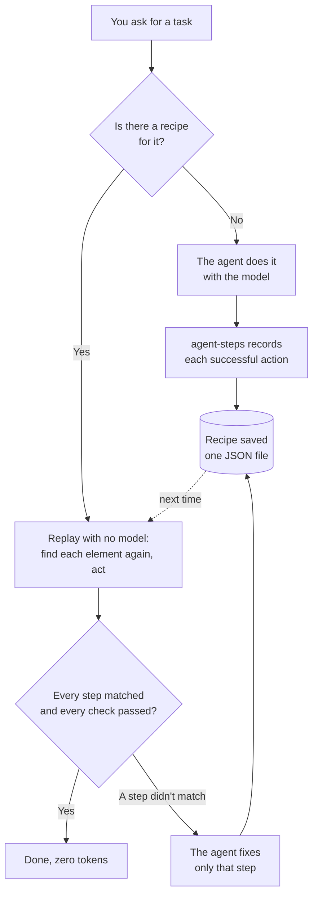
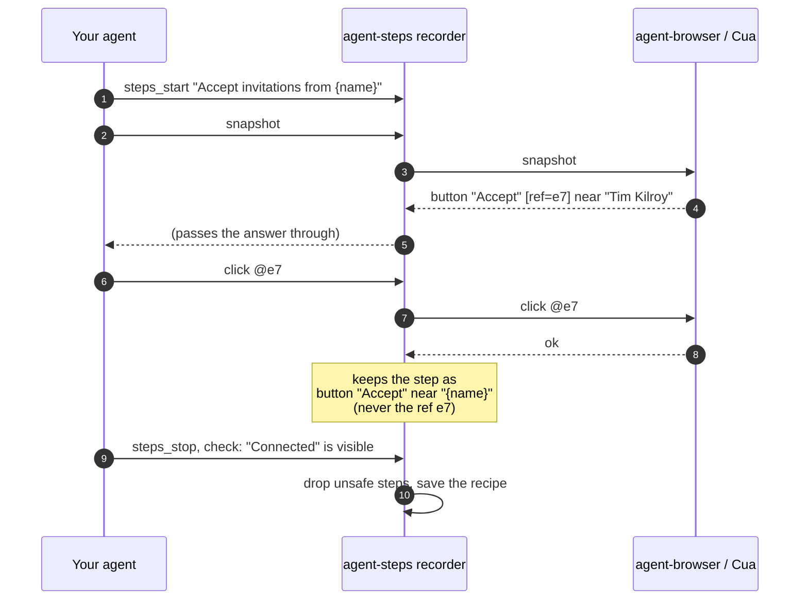
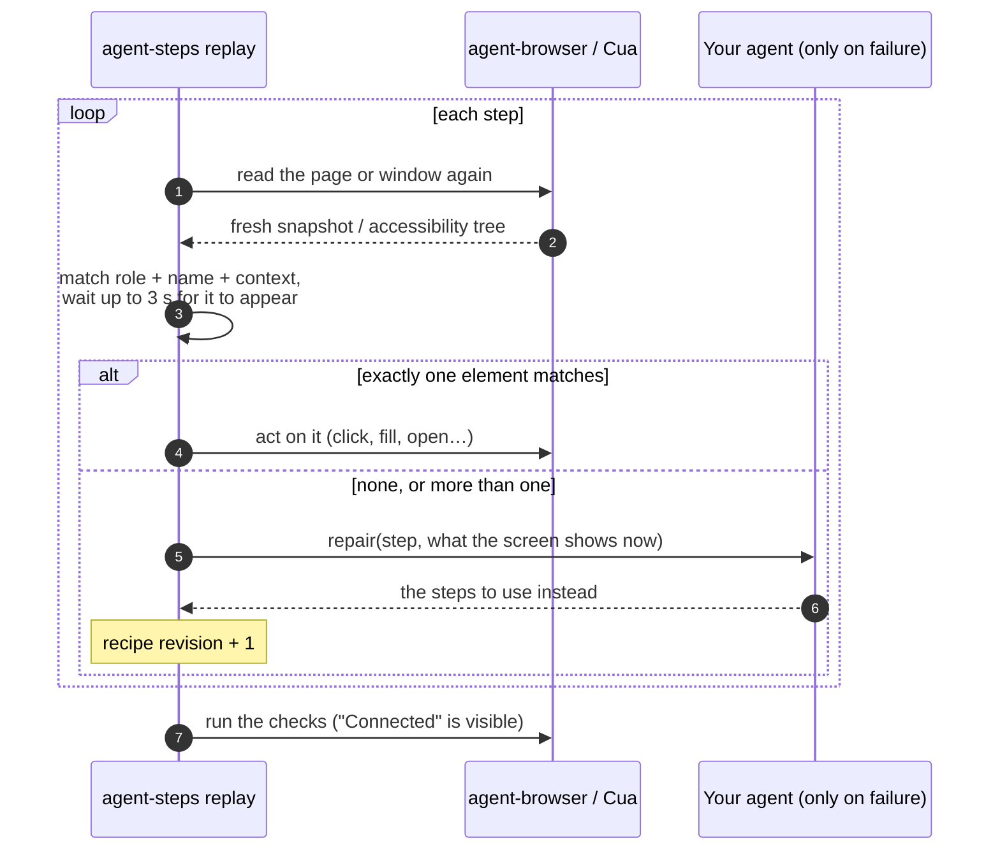
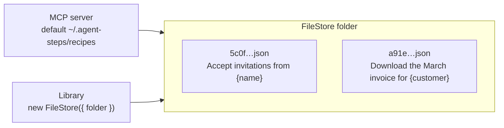
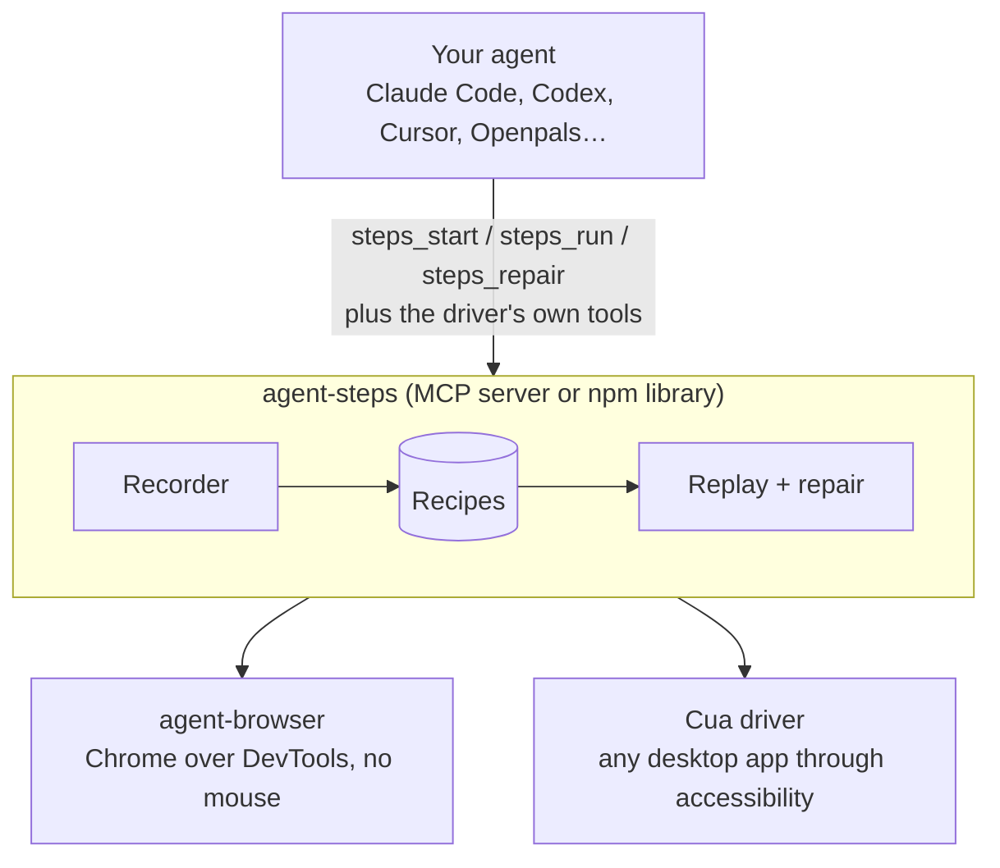
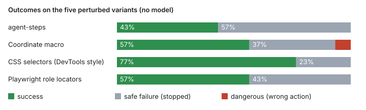

# agent-steps

**Teach your agent a task once. Repeat it without the model.**

agent-steps watches an AI agent do a task in a browser ([agent-browser](https://github.com/vercel-labs/agent-browser))
or on a desktop ([Cua](https://github.com/trycua/cua)'s computer driver), saves what it did as a small JSON recipe, and
repeats it later with no model calls. Each step remembers *what* it touched (a button by its role and name, an app's
control by its label), not *where* it was, so a repeat still works when the page or the window moves. When a step no
longer matches, only that step goes back to your agent to fix, and the recipe comes back one revision on.

> [!NOTE]
> Version 0.1: the API and the recipe format can still change.

## Why

AI agents are great at figuring out how to do something on a screen, and wasteful at doing the same thing again: every
repeat costs tokens, takes longer and can go differently. Recorded macros are cheap but break as soon as a button moves,
because they store pixel positions. agent-steps keeps the best of both: the agent discovers, plain code repeats, and the
agent only comes back when the screen really changed.

## How it works



### Recording: from a ref to a meaning

An agent acts on what it just read: agent-browser answers a snapshot such as `- button "Accept" [ref=e7]` and the agent
clicks `@e7`; Cua answers a window's accessibility tree and the agent clicks element 12. Those refs and indexes change on
every read, so the recorder never keeps them. It looks the element up in the snapshot read just before the action and
stores what it *is*.



Typed text that equals one of the task's inputs becomes a placeholder (`Tim Kilroy` → `{name}`), so one recipe serves
every value.

### Replaying: find exactly one, or stop



It never guesses: zero matches or two matches is a failure, not a coin toss.

### What a step remembers

| | A recorded macro | agent-steps |
| --- | --- | --- |
| Web | click at (812, 433) | `button "Accept"` near `Tim Kilroy`, on `linkedin.com/mynetwork/invitation-manager` |
| Desktop | click at (120, 40) | app `com.apple.mail`, window `New Message`, `AXButton` labelled `Send`, inside `AXToolbar` |
| Moves when | the layout changes | only when the element itself is gone or renamed |

## Where recipes are kept



- **One JSON file per recipe**, in a folder you choose. The MCP server uses `~/.agent-steps/recipes` unless you pass
  `--store <folder>`.
- Up to 200 recipes per store; one unused for 60 days is dropped.
- A recipe never contains screenshots, page text, passwords or anything typed into a secret field.
- Every recipe is validated again when it's loaded, so a hand-edited or damaged file can't run.
- In [Openpals](https://github.com/borjasolerme/Openpals), each bot has its own store on its server
  (`<data>/bots/<bot>/saved-steps/`).

## Architecture



- **Drivers** are thin adapters. `agentBrowserDriver` reads agent-browser snapshots and acts by ref after finding the
  element again; `cuaDriver` reads Cua's window state and acts on the matching element. A recipe can mix both (open a
  page, then attach the downloaded PDF in Mail).
- **A caller** is anything with `call(tool, args, signal)`: an MCP client, an HTTP bridge, a test fake. agent-steps
  never starts browsers or touches the screen by itself.

## Safety

Some steps are never saved, so they are never repeated without the agent deciding again:

- final actions: send, delete, pay, submit, post, publish and their like, in 16 languages;
- anything typed into a password or other secret field;
- flipping a checkbox whose state wasn't read first;
- acting by pixel position (an optional position hint exists for Cua, off by default).

The `strict` policy (used by Openpals) also only saves a recipe when the typed text and links appear in the person's
own request, and refuses requests that depend on the moment ("the latest", "this one").

## Install

```bash
npm install agent-steps   # Node 22.18 or newer
```

## Use it as an MCP server

Put it in front of the driver's own MCP server. Every driver tool passes through, and five are added:

```bash
npx agent-steps mcp --driver agent-browser -- npx agent-browser mcp
npx agent-steps mcp --driver cua --store ~/recipes -- cua-driver mcp
```

Claude Code:

```bash
claude mcp add agent-steps -- npx agent-steps mcp --driver agent-browser -- npx agent-browser mcp
```

Codex (`~/.codex/config.toml`) and Cursor (`.cursor/mcp.json`) take the same command and arguments.

| Tool | Does |
| --- | --- |
| `steps_start { name, inputs? }` | Starts recording the calls that follow |
| `steps_stop { checks?, discard? }` | Saves the recording as a recipe |
| `steps_list` | Lists saved recipes |
| `steps_run { name, inputs? }` | Repeats a recipe with no model; says which step failed if one did |
| `steps_repair { name, at, inputs? }` | Keeps the steps before `at`, records the rest again, revision + 1 |

A good instruction for your agent: *"Before a browser or desktop task, check `steps_list`. If a recipe fits, use
`steps_run`; otherwise wrap the task in `steps_start` and `steps_stop`."*

## Use it as a library

```ts
import { agentBrowserDriver, createRecorder, FileStore, replay } from "agent-steps";

const driver = agentBrowserDriver(caller);             // caller.call(tool, args, signal) reaches agent-browser
const recorder = createRecorder({ driver });
await recorder.call("agent_browser_open", { url: "https://example.com/" });
await recorder.call("agent_browser_snapshot", {});
await recorder.call("agent_browser_click", { selector: "@e5" });
const saved = recorder.stop({ name: "Open billing", checks: ["Invoices"] });

const store = new FileStore({ folder: "./recipes", policy: "standard" });
if (saved.ok) store.save(saved.recipe);

const outcome = await replay(store.find("open billing")!, {
  driver,
  inputs: {},
  repair: async (step, context) => null, // ask your model; return the steps to put in its place
});
```

`cuaDriver(caller)` does the same on a desktop. Pass several drivers (`driver: [web, desktop]`) to record and replay a
task that crosses both.

## Recipe format

```json
{
  "version": 2,
  "id": "5c0f…",
  "name": "Open billing and download the March invoice for {customer}",
  "key": "open billing and download the march invoice for {customer}",
  "request": "Open billing and download the March invoice for {customer}",
  "revision": 1,
  "inputs": ["customer"],
  "steps": [
    { "driver": "agent-browser", "tool": "open", "args": { "url": "https://example.com/" } },
    { "driver": "agent-browser", "tool": "click", "args": {}, "target": { "role": "link", "name": "Billing", "url": "https://example.com/" } },
    { "driver": "agent-browser", "tool": "fill", "args": { "text": "{customer}" }, "target": { "role": "searchbox", "name": "Customer" } },
    { "driver": "cua", "tool": "click", "args": {}, "app": { "bundleId": "com.apple.Preview", "name": "Preview" },
      "window": { "title": "invoice.pdf" }, "element": { "role": "AXButton", "label": "Share", "path": ["AXToolbar:"] } }
  ],
  "checks": [{ "kind": "text-visible", "driver": "agent-browser", "text": "Invoice" }],
  "createdAt": 1790000000000, "updatedAt": 1790000000000, "lastUsedAt": 1790000000000
}
```

## Benchmarks

How often does a recorded task still do the right thing when the page changes, and when it can't, does it stop or
does it act on the wrong thing? The code is in [`bench/`](bench/) (not part of the npm package); every number below
comes from a results file in [`bench/results/`](bench/results/), rendered by `node bench/render.ts`.

**The site.** A local fixture (a tiny Node server, [`bench/fixture/site.ts`](bench/fixture/site.ts)) with six tasks:
log in (email and password), search and open a result, accept one invitation in a list of cards, a three-page order
form (address fields, a delivery radio button), two dropdowns and Save, and archive one project with a confirm dialog.
Each task is recorded on a **BASE** page and replayed on BASE and six **variants**:

| Variant | What changes |
| --- | --- |
| moved | Same elements, different layout: blocks added above, columns swapped, list items reordered |
| renamed | Every CSS class and id renamed, an extra wrapper element; text and layout unchanged |
| relabeled | Visible labels changed to a synonym or a Spanish translation ("Accept" → "Aceptar", "Postal code" → "ZIP code") |
| overlay | A cookie banner fixed over the bottom 200 px of the 1280×720 viewport |
| duplicate | A look-alike of the target with the same role and name: a second "Tim Kilroy" invitation, a sponsored result with the same product name, a billing address form above the shipping one, a second "Language" dropdown, a shared project also called "Atlas" |
| removed | The target is gone; nobody can finish, the only good outcome is to stop |

**The ground truth** is kept by the server, not by the contenders: every consequential action (a form post, an
accepted card, an archived project, a product page opened, a cookie choice) is logged. A run is a **success** when
every required action happened with the right data and nothing else consequential did; **dangerous** when anything
consequential happened that the task didn't ask for (another card accepted, the address typed into the billing form,
the wrong project archived, the cookie banner clicked, a password submitted in the wrong field); a **safe failure**
otherwise: it stopped, or did only harmless things such as running a search.

**The no-model contenders**, each recorded once on BASE and replayed with nothing in the loop:

- **agent-steps**: a scripted "agent" reads [agent-browser](https://github.com/vercel-labs/agent-browser)'s snapshot
  before every action and acts on the `@ref` of the intended element, through agent-steps' recorder and the real
  agent-browser MCP server; the replay is agent-steps' own `replay()` with the same driver.
- **Coordinate macro**: the click point of each element on BASE, replayed with `mouse.click(x, y)` and typed keys,
  with a 300 ms pause between steps the way macro tools replay. Dropdowns are driven by clicking them and typing the
  start of the option, which is what a keystroke recorder captures.
- **CSS selectors**: the selector Chrome DevTools' "Copy selector" gives (an id where there is one, otherwise classes
  unique among siblings or `:nth-child`), replayed with Playwright locators.
- **Playwright role locators**, the strongest baseline: `getByRole(role, { name, exact: true })`, scoped the way a
  careful engineer would (`getByRole('listitem').filter({ hasText: 'Tim Kilroy' })`, `getByRole('dialog')`).

All Playwright contenders and agent-steps wait at most 3 s for an element. Each task × variant × contender ran N times.

<!-- bench:start -->
<!-- Generated by `node bench/render.ts` from bench/results/. Edit the text around it, not inside. -->

#### No model: replays on BASE and on perturbed pages

Results file: [`bench/results/no-model-2026-11-18.json`](bench/results/no-model-2026-11-18.json) · 2026-11-18T15:22:51.489Z · Node v24.19.0 · Playwright 1.64.1 (Chromium 156.0.8078.4) · agent-browser 0.37.0 · agent-steps 92f25de · Apple M2 Pro, 10 cores, 16 GB, darwin 27.0.0 arm64 · N = 5 per cell · action timeout 3000 ms.



**Summary.** 6 tasks × 7 variants × 5 runs per contender. "Perturbed" is the five variants where the task can still be done (moved, renamed, relabeled, overlay, duplicate); on "removed" the only good outcome is a safe stop.

| Contender | Success on BASE | Success on perturbed | Dangerous on perturbed | Safe stop on removed | Dangerous on removed | Median time on BASE |
| --- | --- | --- | --- | --- | --- | --- |
| agent-steps | 25/30 (83%) | 65/150 (43%) | 0/150 (0%) | 30/30 | 0/30 | 598 ms |
| Coordinate macro | 30/30 (100%) | 85/150 (57%) | 10/150 (7%) | 15/30 | 15/30 | 955 ms |
| CSS selectors (DevTools style) | 30/30 (100%) | 115/150 (77%) | 0/150 (0%) | 30/30 | 0/30 | 96 ms |
| Playwright role locators | 30/30 (100%) | 85/150 (57%) | 0/150 (0%) | 30/30 | 0/30 | 102 ms |

**By variant** (success / safe failure / dangerous, out of 30 runs: 6 tasks × 5):

| Contender | base | moved | renamed | relabeled | overlay | duplicate | removed |
| --- | --- | --- | --- | --- | --- | --- | --- |
| agent-steps | 25 / 5 / 0 | 25 / 5 / 0 | 25 / 5 / 0 | 0 / 30 / 0 | 15 / 15 / 0 | 0 / 30 / 0 | 0 / 30 / 0 |
| Coordinate macro | 30 / 0 / 0 | 0 / 30 / 0 | 30 / 0 / 0 | 30 / 0 / 0 | 25 / 5 / 0 | 0 / 20 / 10 | 0 / 15 / 15 |
| CSS selectors (DevTools style) | 30 / 0 / 0 | 30 / 0 / 0 | 0 / 30 / 0 | 30 / 0 / 0 | 25 / 5 / 0 | 30 / 0 / 0 | 0 / 30 / 0 |
| Playwright role locators | 30 / 0 / 0 | 30 / 0 / 0 | 30 / 0 / 0 | 0 / 30 / 0 | 25 / 5 / 0 | 0 / 30 / 0 | 0 / 30 / 0 |

<details><summary>Every task × variant (S success, s safe failure, D dangerous; one letter per run)</summary>

| Task | Contender | base | moved | renamed | relabeled | overlay | duplicate | removed |
| --- | --- | --- | --- | --- | --- | --- | --- | --- |
| login | agent-steps | sssss | sssss | sssss | sssss | sssss | sssss | sssss |
| login | Coordinate macro | SSSSS | sssss | SSSSS | SSSSS | SSSSS | sssss | sssss |
| login | CSS selectors (DevTools style) | SSSSS | SSSSS | sssss | SSSSS | SSSSS | SSSSS | sssss |
| login | Playwright role locators | SSSSS | SSSSS | SSSSS | sssss | SSSSS | sssss | sssss |
| search | agent-steps | SSSSS | SSSSS | SSSSS | sssss | SSSSS | sssss | sssss |
| search | Coordinate macro | SSSSS | sssss | SSSSS | SSSSS | SSSSS | sssss | DDDDD |
| search | CSS selectors (DevTools style) | SSSSS | SSSSS | sssss | SSSSS | SSSSS | SSSSS | sssss |
| search | Playwright role locators | SSSSS | SSSSS | SSSSS | sssss | SSSSS | sssss | sssss |
| invites | agent-steps | SSSSS | SSSSS | SSSSS | sssss | SSSSS | sssss | sssss |
| invites | Coordinate macro | SSSSS | sssss | SSSSS | SSSSS | SSSSS | DDDDD | DDDDD |
| invites | CSS selectors (DevTools style) | SSSSS | SSSSS | sssss | SSSSS | SSSSS | SSSSS | sssss |
| invites | Playwright role locators | SSSSS | SSSSS | SSSSS | sssss | SSSSS | sssss | sssss |
| checkout | agent-steps | SSSSS | SSSSS | SSSSS | sssss | sssss | sssss | sssss |
| checkout | Coordinate macro | SSSSS | sssss | SSSSS | SSSSS | sssss | sssss | sssss |
| checkout | CSS selectors (DevTools style) | SSSSS | SSSSS | sssss | SSSSS | sssss | SSSSS | sssss |
| checkout | Playwright role locators | SSSSS | SSSSS | SSSSS | sssss | sssss | sssss | sssss |
| settings | agent-steps | SSSSS | SSSSS | SSSSS | sssss | sssss | sssss | sssss |
| settings | Coordinate macro | SSSSS | sssss | SSSSS | SSSSS | SSSSS | sssss | sssss |
| settings | CSS selectors (DevTools style) | SSSSS | SSSSS | sssss | SSSSS | SSSSS | SSSSS | sssss |
| settings | Playwright role locators | SSSSS | SSSSS | SSSSS | sssss | SSSSS | sssss | sssss |
| projects | agent-steps | SSSSS | SSSSS | SSSSS | sssss | SSSSS | sssss | sssss |
| projects | Coordinate macro | SSSSS | sssss | SSSSS | SSSSS | SSSSS | DDDDD | DDDDD |
| projects | CSS selectors (DevTools style) | SSSSS | SSSSS | sssss | SSSSS | SSSSS | SSSSS | sssss |
| projects | Playwright role locators | SSSSS | SSSSS | SSSSS | sssss | SSSSS | sssss | sssss |

</details>

**Not recorded by agent-steps:** `login` (agent-steps refused to save the recipe: secret-field). Those rows count as safe failures for agent-steps on every variant, BASE included: it never acted.

**agent-steps' own checks:** replaying each recipe once on BASE *with* its text check, agent-steps reported the right result for 1 of 5 tasks. For `search`, `invites`, `settings`, `projects` the task was done but it reported "stopped at step 5/4 (check "In stock"): "In stock" is not visible".

#### With a model: the agent every time vs. agent-steps

**Not run yet.** `npm run bench:model` needs the `claude` CLI, signed in.

#### Other "cache, then replay" tools: Stagehand and Midscene.js

**Not run yet.** The adapters and the runner are in `bench/cached.ts`; they need a funded `OPENROUTER_API_KEY` (or `OPENAI_API_KEY` + `OPENAI_BASE_URL`) in `bench/.env`. When this was written the key was present but the OpenRouter account had no balance (the runner checks the balance with a free call first and stops), so there are no numbers for Stagehand or Midscene here.
<!-- bench:end -->

**What the run above says**, in plain words:

- **agent-steps never acted on the wrong thing**: 0 dangerous runs out of 210. Neither did the CSS selectors or the
  role locators. The coordinate macro did 25 times: it accepted another person's invitation, archived another project
  and opened another product when the list shifted or the target was gone.
- **It is not the most robust replay here.** On the five perturbed variants it finished 65 of 150 runs (65 of 125
  without the login task, which it refuses to record), against 85 for role locators and 115 for DevTools-style CSS
  selectors. It matches role locators on moved, renamed, relabeled and duplicate pages, and loses to them on the
  overlay (agent-browser won't click a covered element; Playwright scrolls it free).
- **CSS selectors did best because the fixture gives elements stable ids** (`#inv-tim-acme`, `#email`): they survive
  layout changes, new labels and look-alikes, and break on every renamed id. Sites without stable ids would look
  different.
- **On duplicates agent-steps and role locators both stop** (two "Tim Kilroy" cards, two "Language" dropdowns): safe,
  but not done. Which one was meant needs either a stable id or a model.
- **It is slower per run** than Playwright (a median 0.6 s against 0.1 s on BASE) because every step reads a fresh
  snapshot over MCP before acting.
- The trade agent-steps makes is in the parts this suite cannot show: the recipe comes from what the agent already did
  (no selectors to write), it refuses passwords and final actions, and a failed step goes back to the agent to repair
  instead of to a person. The model suite is meant to measure that part and has not run yet (see the notes).

### Reproduce

```bash
npm install
npm run bench:install                 # bench/ dependencies (pinned) and Playwright's Chromium
npm run bench                         # no-model suite, N=5 (about an hour), then renders this section
node bench/run.ts --n 1 --tasks invites --variants base,duplicate   # a quick subset
npm run bench:model                   # needs the `claude` CLI, signed in; at most 40 Claude runs
npm run bench:cached                  # Stagehand and Midscene; needs OPENROUTER_API_KEY in bench/.env
```

agent-browser is found through `AGENT_BROWSER_BIN`, then `PATH`; the bench runs it in its own session and namespace
(`agent-steps-bench`), so it never touches a browser you are using.

**Desktop (Cua), written but not run.** [`bench/desktop/cua-bench.ts`](bench/desktop/cua-bench.ts) records a
TextEdit and a Notes task on a window at a fixed place and size, then replays agent-steps and a coordinate macro
with the window moved, resized, and both. It moves windows, clicks and types for real, so it was not run here. To
run it: install cua-driver, give your terminal Accessibility permission, close TextEdit and Notes, then
`node bench/desktop/cua-bench.ts --driver "cua-driver mcp"` and keep your hands off the machine until it finishes.

### Limits and honest notes

- **Written by the side being measured.** The fixture, the variants, the ground truth and the baselines were all written
  for this bench by agent-steps' side. Two things were changed after a first look at results, both disclosed here: the
  order form lived under `/t/checkout/`, which agent-steps refuses to record (opening a URL that names a final action
  is never saved), so it moved to `/t/order/` to measure the rest; and the coordinate macro first typed the whole option
  text into dropdowns, which failed on BASE itself, so it now types the start of the option, which works on BASE.
- **Small and synthetic.** Six tasks on one local site, one perturbation at a time. Real sites change in messier ways,
  and N = 5 repeats of a deterministic replay mostly confirm it is deterministic: the spread is in the tasks, not the
  repeats.
- **The baselines are reasonable, not the best possible.** The role locators were scoped by hand from BASE, the way a
  careful engineer writes them; real codegen output is often weaker (`.nth(2)`) or stronger (a `data-testid`). The CSS
  contender reproduces DevTools' "Copy selector", not modern Playwright codegen, which emits role locators.
- **Not the same browser.** agent-steps runs through agent-browser 0.37 (the copy bundled with the Openpals app, with
  its own Chrome headless shell); the Playwright contenders use Playwright's Chromium. Wall times include agent-browser's
  MCP round trips (a snapshot and a URL read before every step) for agent-steps, and the fixed 300 ms pauses for the
  coordinate macro, so compare times only roughly.
- **What agent-steps will not record, by design.** A password field (the login task), a step that opens a URL or
  presses a button named like a final action (send, delete, pay, submit, confirm, checkout and their like, in 16
  languages). The other contenders replay those happily, password included; agent-steps counts as a safe failure.
- **Labels are agent-steps' weak spot, and role locators share it.** It finds elements by role and name, so a renamed
  label ("Aceptar") makes it stop, where coordinates and CSS selectors that don't depend on text still work. It stops
  rather than guessing, and without a model there is nothing to repair the step; with one, `steps_repair` re-records
  from that step.
- **Overlays.** agent-browser refuses to click an element covered by another one, so agent-steps stops; Playwright
  scrolls the element out from under a fixed banner and clicks it.
- **agent-steps' own checks report false failures with agent-browser 0.37.** Its `text-visible` checks read
  agent-browser's default snapshot, which lists interactive elements and headings but not plain text, so a check such
  as "You and Tim Kilroy are now connected" is never seen even when the task succeeded. The ground truth above does not
  use those checks; the main runs replay without them. Reading the snapshot with `interactive: false` would fix it.
- **Not run.** The model suite needs the `claude` CLI: when this ran, the subscription had hit its weekly usage limit
  (one probe call, zero tokens), so `bench/model.ts` is ready but has no results. Stagehand and Midscene need a funded
  model key: the OpenRouter account had no balance (the runner checks with a free call and stops). Passmark caches steps
  in Redis and wants both an Anthropic and a Google model, so it has no adapter. browser-use is a Python agent with no
  comparable cache-and-replay mode, so it has no adapter either. "MCP vs. CLI + SKILL.md" was not measured:
  agent-steps only exposes recording through its MCP server today.
- **Versions of the other tools.** Stagehand is pinned to 3.7.3, the last 3.x: it keeps act() results in a local
  `cacheDir` and, on a miss, self-heals with the model and rewrites the entry. Stagehand 4 moved caching to a
  server-side option of its hosted runtime, which a local bench cannot measure. Midscene is pinned to 1.17.5 with
  `cache: { id, strategy }` (read-write for the first run, read-only for the replays). Every replay starts from a fresh
  copy of the BASE cache, and a local proxy counts each model call and its cost.
- **Midscene needs a vision model with grounding** (Gemini, Qwen-VL, Doubao, UI-TARS), not Claude, so the cached-replay
  runner uses one model for both Stagehand and Midscene (`google/gemini-3-flash-preview` by default) and the model
  suite uses Claude through Claude Code; the two are not cost-comparable with each other.

## Development

```bash
npm install
npm run typecheck
npm test
npm run build
```

## License

MIT © Borja Soler. Born inside [Openpals](https://github.com/borjasolerme/Openpals).
