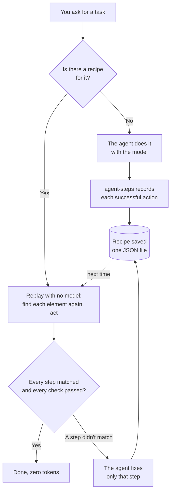
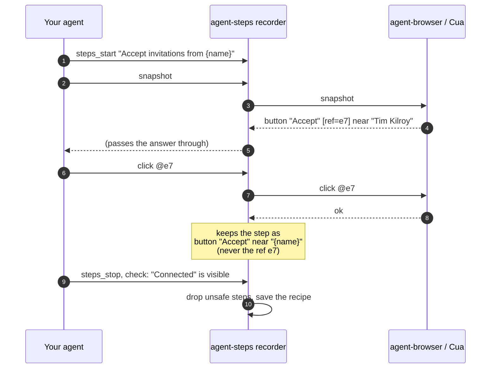
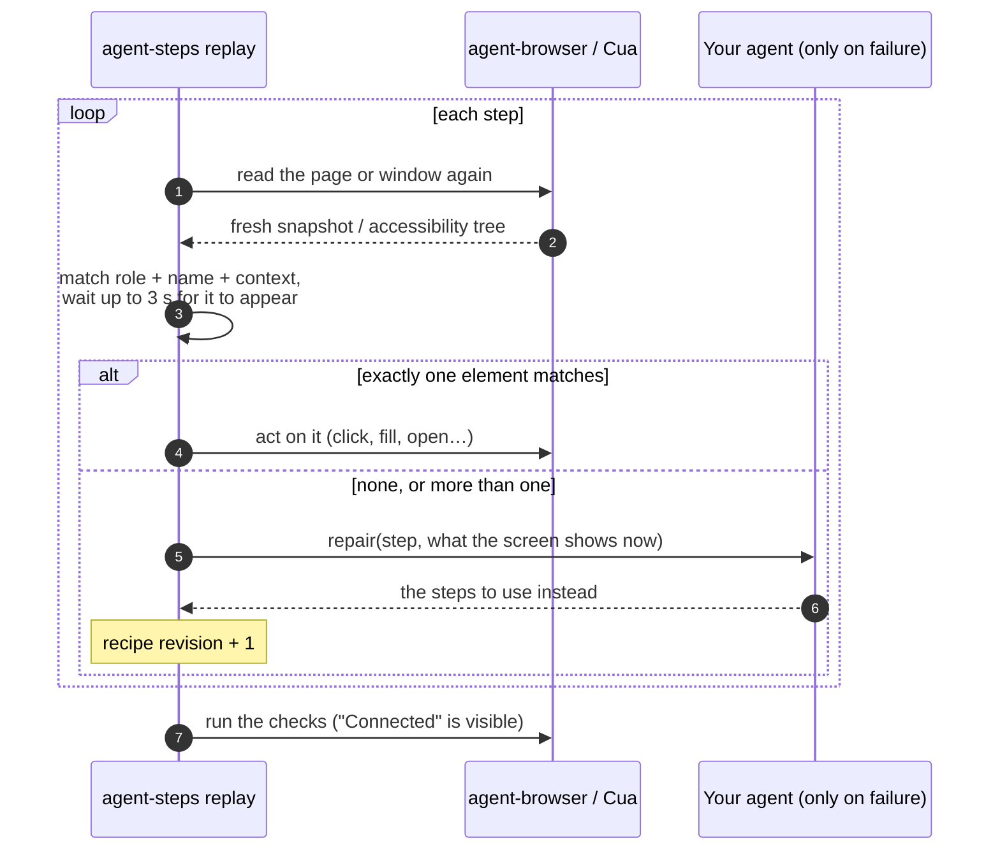
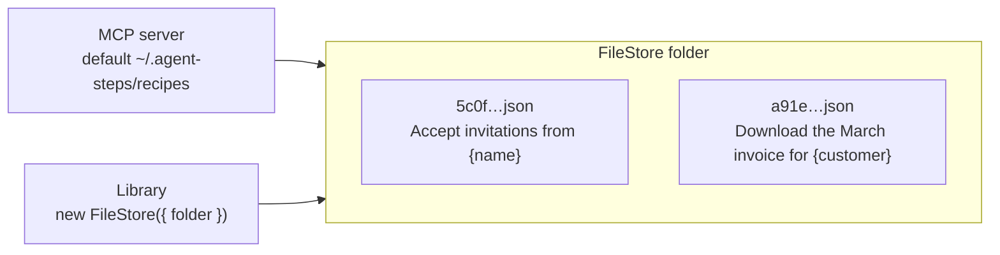
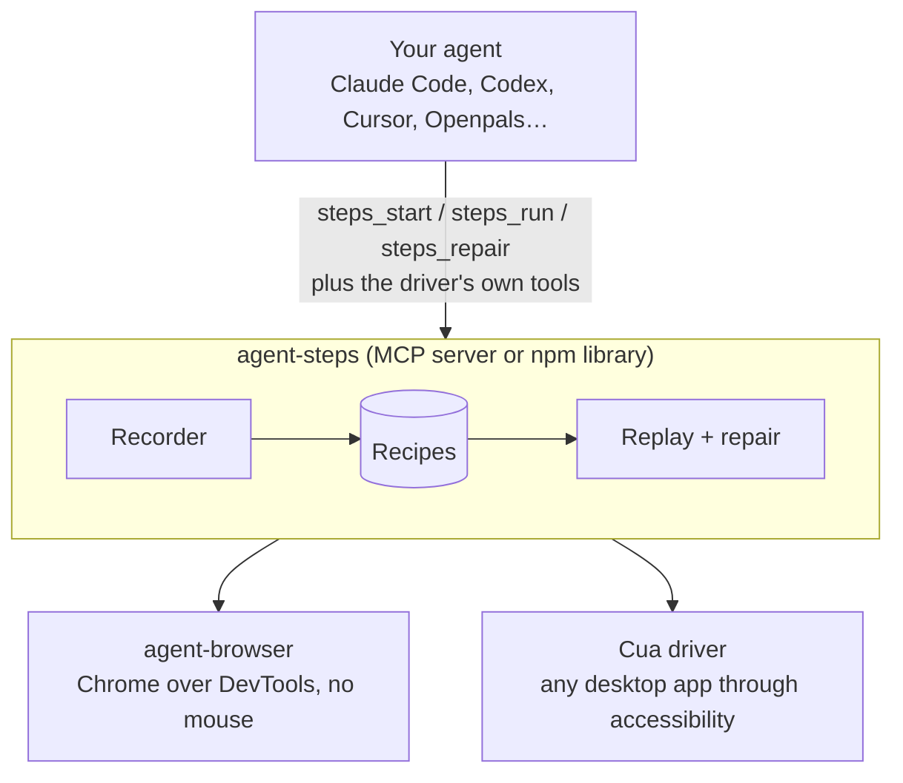

# agent-steps

**Teach your agent a task once. Repeat it without the model.**

agent-steps watches an AI agent do a task in a browser ([agent-browser](https://github.com/vercel-labs/agent-browser))
or on a desktop ([Cua](https://github.com/trycua/cua)'s computer driver), saves what it did as a small JSON recipe, and
repeats it later with no model calls. Each step remembers *what* it touched (a button by its role and name, an app's
control by its label), not *where* it was, so a repeat still works when the page or the window moves. When a step no
longer matches, only that step goes back to your agent to fix, and the recipe comes back one revision on.

> [!NOTE]
> Version 0.1: the API and the recipe format can still change.

## Why

AI agents are great at figuring out how to do something on a screen, and wasteful at doing the same thing again: every
repeat costs tokens, takes longer and can go differently. Recorded macros are cheap but break as soon as a button moves,
because they store pixel positions. agent-steps keeps the best of both: the agent discovers, plain code repeats, and the
agent only comes back when the screen really changed.

## How it works



### Recording: from a ref to a meaning

An agent acts on what it just read: agent-browser answers a snapshot such as `- button "Accept" [ref=e7]` and the agent
clicks `@e7`; Cua answers a window's accessibility tree and the agent clicks element 12. Those refs and indexes change on
every read, so the recorder never keeps them. It looks the element up in the snapshot read just before the action and
stores what it *is*.



Typed text that equals one of the task's inputs becomes a placeholder (`Tim Kilroy` → `{name}`), so one recipe serves
every value.

### Replaying: find exactly one, or stop



It never guesses: zero matches or two matches is a failure, not a coin toss.

### What a step remembers

| | A recorded macro | agent-steps |
| --- | --- | --- |
| Web | click at (812, 433) | `button "Accept"` near `Tim Kilroy`, on `linkedin.com/mynetwork/invitation-manager` |
| Desktop | click at (120, 40) | app `com.apple.mail`, window `New Message`, `AXButton` labelled `Send`, inside `AXToolbar` |
| Moves when | the layout changes | only when the element itself is gone or renamed |

## Where recipes are kept



- **One JSON file per recipe**, in a folder you choose. The MCP server uses `~/.agent-steps/recipes` unless you pass
  `--store <folder>`.
- Up to 200 recipes per store; one unused for 60 days is dropped.
- A recipe never contains screenshots, page text, passwords or anything typed into a secret field.
- Every recipe is validated again when it's loaded, so a hand-edited or damaged file can't run.
- In [Openpals](https://github.com/borjasolerme/Openpals), each bot has its own store on its server
  (`<data>/bots/<bot>/saved-steps/`).

## Architecture



- **Drivers** are thin adapters. `agentBrowserDriver` reads agent-browser snapshots and acts by ref after finding the
  element again; `cuaDriver` reads Cua's window state and acts on the matching element. A recipe can mix both (open a
  page, then attach the downloaded PDF in Mail).
- **A caller** is anything with `call(tool, args, signal)`: an MCP client, an HTTP bridge, a test fake. agent-steps
  never starts browsers or touches the screen by itself.

## Safety

Some steps are never saved, so they are never repeated without the agent deciding again:

- final actions: send, delete, pay, submit, post, publish and their like, in 16 languages;
- anything typed into a password or other secret field;
- flipping a checkbox whose state wasn't read first;
- acting by pixel position (an optional position hint exists for Cua, off by default).

The `strict` policy (used by Openpals) also only saves a recipe when the typed text and links appear in the person's
own request, and refuses requests that depend on the moment ("the latest", "this one").

## Install

```bash
npm install agent-steps   # Node 22.18 or newer
```

## Use it as an MCP server

Put it in front of the driver's own MCP server. Every driver tool passes through, and five are added:

```bash
npx agent-steps mcp --driver agent-browser -- npx agent-browser mcp
npx agent-steps mcp --driver cua --store ~/recipes -- cua-driver mcp
```

Claude Code:

```bash
claude mcp add agent-steps -- npx agent-steps mcp --driver agent-browser -- npx agent-browser mcp
```

Codex (`~/.codex/config.toml`) and Cursor (`.cursor/mcp.json`) take the same command and arguments.

| Tool | Does |
| --- | --- |
| `steps_start { name, inputs? }` | Starts recording the calls that follow |
| `steps_stop { checks?, discard? }` | Saves the recording as a recipe |
| `steps_list` | Lists saved recipes |
| `steps_run { name, inputs? }` | Repeats a recipe with no model; says which step failed if one did |
| `steps_repair { name, at, inputs? }` | Keeps the steps before `at`, records the rest again, revision + 1 |

A good instruction for your agent: *"Before a browser or desktop task, check `steps_list`. If a recipe fits, use
`steps_run`; otherwise wrap the task in `steps_start` and `steps_stop`."*

## Use it as a library

```ts
import { agentBrowserDriver, createRecorder, FileStore, replay } from "agent-steps";

const driver = agentBrowserDriver(caller);             // caller.call(tool, args, signal) reaches agent-browser
const recorder = createRecorder({ driver });
await recorder.call("agent_browser_open", { url: "https://example.com/" });
await recorder.call("agent_browser_snapshot", {});
await recorder.call("agent_browser_click", { selector: "@e5" });
const saved = recorder.stop({ name: "Open billing", checks: ["Invoices"] });

const store = new FileStore({ folder: "./recipes", policy: "standard" });
if (saved.ok) store.save(saved.recipe);

const outcome = await replay(store.find("open billing")!, {
  driver,
  inputs: {},
  repair: async (step, context) => null, // ask your model; return the steps to put in its place
});
```

`cuaDriver(caller)` does the same on a desktop. Pass several drivers (`driver: [web, desktop]`) to record and replay a
task that crosses both.

## Recipe format

```json
{
  "version": 2,
  "id": "5c0f…",
  "name": "Open billing and download the March invoice for {customer}",
  "key": "open billing and download the march invoice for {customer}",
  "request": "Open billing and download the March invoice for {customer}",
  "revision": 1,
  "inputs": ["customer"],
  "steps": [
    { "driver": "agent-browser", "tool": "open", "args": { "url": "https://example.com/" } },
    { "driver": "agent-browser", "tool": "click", "args": {}, "target": { "role": "link", "name": "Billing", "url": "https://example.com/" } },
    { "driver": "agent-browser", "tool": "fill", "args": { "text": "{customer}" }, "target": { "role": "searchbox", "name": "Customer" } },
    { "driver": "cua", "tool": "click", "args": {}, "app": { "bundleId": "com.apple.Preview", "name": "Preview" },
      "window": { "title": "invoice.pdf" }, "element": { "role": "AXButton", "label": "Share", "path": ["AXToolbar:"] } }
  ],
  "checks": [{ "kind": "text-visible", "driver": "agent-browser", "text": "Invoice" }],
  "createdAt": 1790000000000, "updatedAt": 1790000000000, "lastUsedAt": 1790000000000
}
```

## Development

```bash
npm install
npm run typecheck
npm test
npm run build
```

## License

MIT © Borja Soler. Born inside [Openpals](https://github.com/borjasolerme/Openpals).
